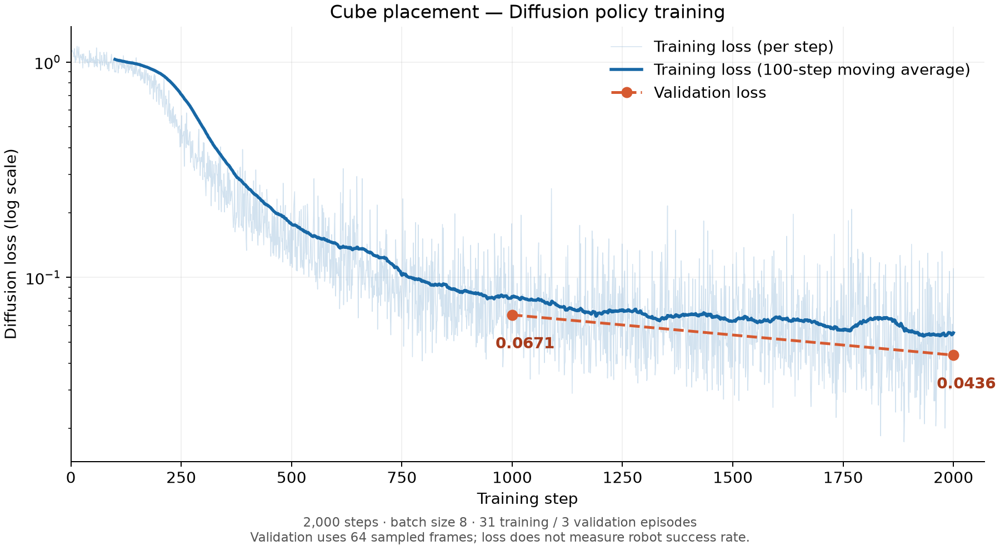

# HRL_2: SO-101 Diffusion Policy

Data collection, successful-demonstration preprocessing, LeRobot diffusion-policy training, real-robot debugging, and STEP evaluation for cube placement.

The current checkpoint was trained for **2,000 steps** with batch size **8**. Validation loss was **0.06705** at step 1,000 and **0.04364** at step 2,000. Robot debugging has confirmed camera input, model inference, and motor motion, but **a successful autonomous cube-to-tray rollout has not yet been demonstrated**.



## Run on the current Mac

Connect the robot USB and power. Put the arm in the demonstration starting pose, with the cube and tray visible in the wrist camera, and keep hands outside its movement area. Close any other program using the camera or robot port.

In Terminal:

```bash
cd /Users/tianai/Desktop/2026-11-09/desktop-cube-placement-v2-github-https/outputs/HRL_2

../../work/venv/bin/python debug_policy_robot.py \
  --checkpoint runs/diffusion_cube/checkpoints/002000 \
  --port /dev/cu.usbmodem5B421342761 \
  --camera 0 \
  --continuous \
  --max-seconds 180 \
  --execution-horizon 8 \
  --body-speed 15 \
  --gripper-speed 40 \
  --max-relative-target 10 \
  --output "eval/robot_test_$(date +%Y%m%d_%H%M%S)"
```

This uses the existing local environment. The camera window shows the live wrist image. **180 means seconds (3 minutes), and is an upper bound.** `--continuous` removes the five-second review pauses. Stop the run when the task succeeds or when an attempt fails; the script does not detect success, hands, or collisions automatically and does not reset the scene.

For a shorter attempt, use `--max-seconds 40`. Camera access must be allowed for Terminal/Python in **System Settings > Privacy & Security > Camera**. The current OpenCV wrist-camera index is `0`; indices can change after reconnecting and can differ from FFmpeg's device order.

### Stop and release

- Press **Q** or **Escape** with the camera window focused, or **Ctrl+C** in Terminal. You can also close the camera window.
- By default, the robot **stops and holds its measured final position with torque enabled**. Do not force the joints by hand.
- To release it, first stop the runner and **support the arm and any held object**, then run:

```bash
../../work/venv/bin/python release_robot.py \
  --port /dev/cu.usbmodem5B421342761
```

The command disables torque on all six motors, verifies their torque-enable registers, and closes the serial port. The arm and gripper can then be moved manually. It does not switch off the power supply or move to a rest pose.

You may add `--release-on-exit` to the rollout command to release automatically on exit. Use this only when the arm is supported at shutdown; it can fall under gravity and the gripper can release its object. Physical power-off is the fallback if software stopping is unresponsive.

### Runtime parameters

| Option | Command above | Meaning |
| --- | --- | --- |
| `--checkpoint` | `checkpoints/002000` | Complete checkpoint directory, including processors |
| `--camera` | `0` | OpenCV wrist-camera index; RGB 640 x 480 |
| `--continuous` | enabled | Run without scheduled review pauses |
| `--max-seconds` | `180` | Maximum active execution time; supported range: 0 < time <= 180 |
| `--execution-horizon` | `8` | Execute eight predicted actions before predicting a new chunk |
| `--body-speed` | `15` | Commanded joint-target rate limit, in degrees per second |
| `--gripper-speed` | `40` | Commanded gripper-target rate limit, in percentage points per second |
| `--max-relative-target` | `10` | Maximum body target lead over measured position, in degrees |
| `--release-on-exit` | disabled | Release motor torque instead of holding on exit |

Rate and target limits constrain commands; they do not guarantee measured speed or prevent collisions. The default relative-target limit is 3 degrees; the command above explicitly selects 10 degrees. Without `--continuous`, the debugging tool pauses after each five-second segment for manual review.

### Saved rollout files

Each run requires a new `--output` directory. The timestamp in the example avoids overwriting previous attempts. Outputs include:

- `settings.json` and `calibration_from_registers.json`: effective deployment settings and calibration snapshot.
- `actions.jsonl`: predicted actions, sent targets, measured positions, and execution timestamps.
- `wrist.mp4`, `before.jpg`, and `latest_frame.jpg`: recorded observations and a periodically refreshed supervision image.
- `status.json` and `result.json`: progress, exit reason, and final state. Debugging runs leave success unset; they are not formal STEP results.

The video is encoded at a nominal 30 FPS. Actual execution may be slower; use `actions.jsonl` timestamps for wall-clock timing. The MPS runner currently reads calibration from motor registers. Feetech software direction flags cannot be recovered this way; verify the convention against the original collection calibration before relying on full task performance. This tool assumes an already configured SO-101 in position mode and leaves the body PID settings unchanged.

## Install on another Mac

```bash
git clone --branch diffusion https://github.com/Azhuan-zhou/HRL_2.git
cd HRL_2
git lfs install
git lfs pull
python3.12 -m venv .venv-diffusion
source .venv-diffusion/bin/activate
python -m pip install -r requirements-diffusion.txt
```

Git LFS must already be installed. Model weights and optimizer states use LFS; a small text pointer is not the actual model. Keep the **entire** `runs/diffusion_cube/checkpoints/002000/` folder, including configuration and normalization processors.

Run the same rollout command with `python debug_policy_robot.py` instead of `../../work/venv/bin/python debug_policy_robot.py`. Update `--port` and `--camera` for that computer. The debugging runner currently uses MPS and macOS AVFoundation; it is not a portable Linux/CUDA deployment entry point.

## Preview the camera

Set `cameras.wrist.index_or_path` in `config.json`, then run:

```bash
python collect.py preview
```

This opens the configured camera without connecting the motors. Verify the image, then press **q** to close it before starting a rollout. Preview and policy execution cannot share the camera reliably.

## Prepare data and train

The original dataset is expected at `~/Desktop/cube_placement_v2`. Preprocessing keeps only saved successful episodes and removes the first and last 15 frames of each episode, with synchronized image, state, and action trimming.

```bash
python prepare_diffusion_data.py
python train_diffusion.py --device mps --batch-size 8 --stop-after 2000
```

The training command requires a new output directory. To start another run when the default already exists, add `--output runs/diffusion_new`. To continue the existing run from step 2,000 to step 3,000:

```bash
python train_diffusion.py \
  --device mps \
  --data data/cube_placement_v2_diffusion \
  --output runs/diffusion_cube \
  --resume runs/diffusion_cube/checkpoints/002000 \
  --stop-after 3000
```

Resume restores the original training settings and optimizer state. `--stop-after` controls the stopping point without changing the original 30,000-step learning-rate schedule. The processed dataset contains 34 successful episodes and 31,692 frames, split into 31 training and 3 validation episodes. Normalization uses only training episodes.

**Videos are intentionally excluded from Git.** Committed data tables and metadata alone are not a complete training dataset. Restore the matching local videos or regenerate the processed dataset from the original recordings before training.

See [DIFFUSION.md](DIFFUSION.md) for architecture, preprocessing, training, and the planned execution-horizon comparison. Formal evaluation uses `evaluate_diffusion.py` and `run_diffusion.py`, separate from the debugging runner.

## Collect demonstrations

Use the existing calibrated collection environment, set both robot ports and calibration-file paths in `config.json`, and verify camera indices. The checked-in calibration paths refer to the original collection computer and must be updated elsewhere. Do not overwrite the original calibration just to resolve a path error.

```bash
python collect.py check
python collect.py teleop --dry-run
python collect.py teleop
python collect.py record --name cube_test --episodes 2
python collect.py inspect --name cube_test
```

In manual recording mode, **Enter** starts and ends an episode; **s** marks success and **f** marks failure, followed by Enter. Both outcomes are saved. While waiting, **q + Enter** exits. `--episodes` is a session target, not a hard limit. Use `--timed` for timed recording and `--resume` to append to an existing valid dataset.

Saved outcome labels are appended to `data/<name>/meta/manual_outcomes.jsonl`. Only records with `status="saved"` confirm a completed save; pending labels alone are not valid training labels. Keep the complete dataset and original calibration for reproducible training and deployment.

## References

- [Assignment 2](https://hands-on-robot-learning.github.io/assignments/assignment-2/)
- [LeRobot SO-101 setup](https://huggingface.co/docs/lerobot/so101)
- [LeRobot imitation learning](https://huggingface.co/docs/lerobot/il_robots)
